# Interface mockups

The 13 screens of the interface as they were validated, before and while they were built (the technical side is in [`TECHNICAL.md`](../TECHNICAL.md), section "User interface"). They are design mockups, not screenshots of the game: the figures on screen (prices, upkeep, payouts) are placeholders, and some have been tuned since. The explosive charge costs 250 in the game, and the jackhammer's upkeep is a flat fee per mission plus a rate per second of work, not a fee per use.

## Interactive version

[`ui-mockups.html`](ui-mockups.html) is the whole design canvas in one self-contained file (16 MB, the fonts are embedded): the final layout at the top, the earlier rounds of proposals below it. The shop is interactive.

- Online: <https://atomium90.github.io/PlotBuilder/Docs/UI/ui-mockups.html>
- Locally: download the file and open it in a browser. On github.com it is shown as code, not rendered, so use the online address.

## Hub: the PC terminal and the debrief

**Contracts tab.** The board of three offers, the details of the hovered card in a strip under the cards.

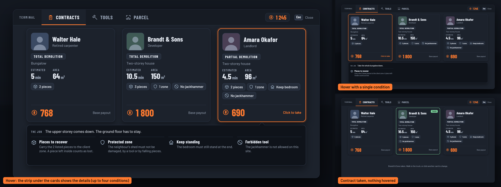

**Tools tab.** Owned, can buy, too expensive, and a consumable with a quantity.

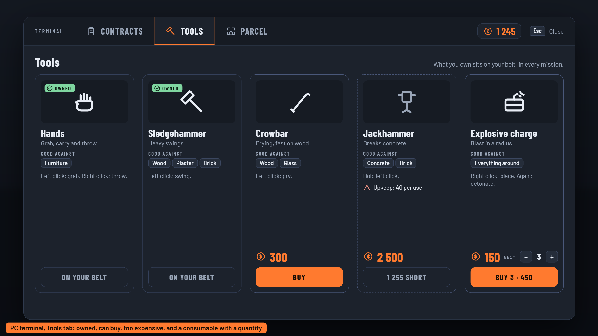

**Parcel tab.** The three states of the button.

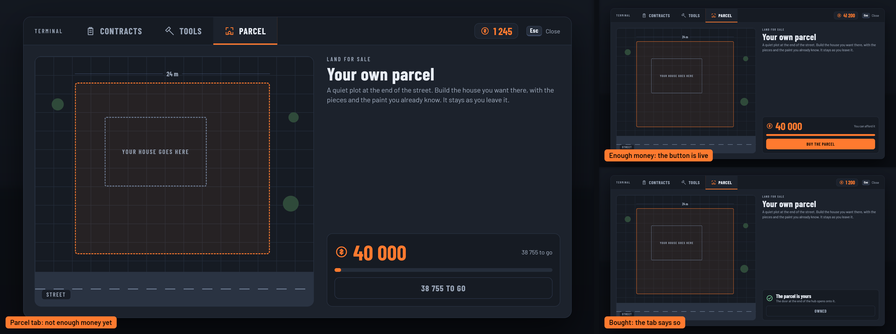

**Debrief.** Shown at the hub on return: a waterfall from the base payout to the payout.

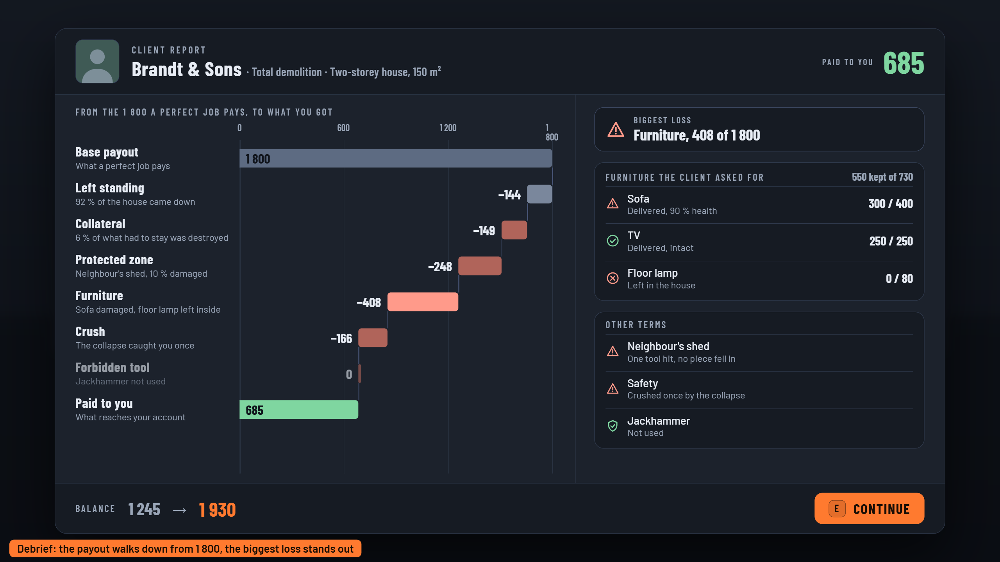

## In play: the HUD, the notebook and the exit

**HUD** in the three kinds of map. The mission (on the left): progress ring, notebook reminder, tool label and a warning in the message line. The home (top right): building and painting on, demolition off. The hub (bottom right): belt locked, the PC and the truck.

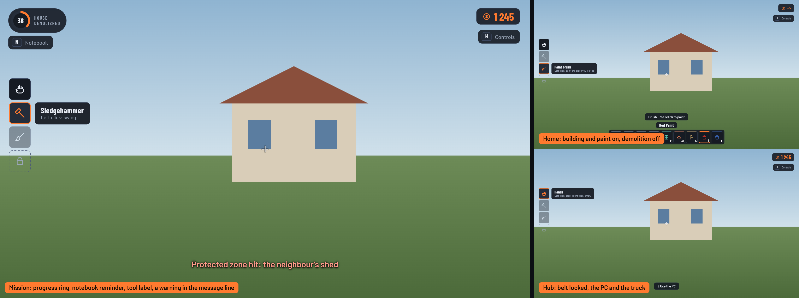

**Controls hint.** In the home, with the build mode group (left); in a mission, with no build group and the notebook key listed (top right); and folded to a small reminder after H (bottom right).

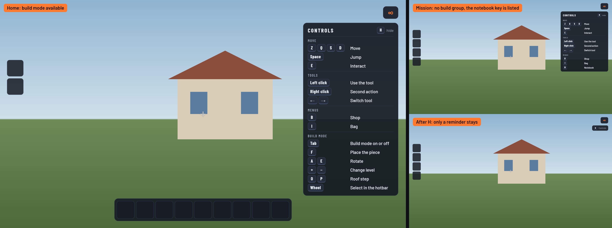

**Mission notebook.** The contract on the left page, the live objectives on the right.

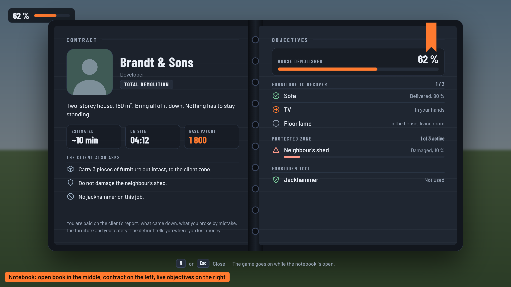

**Mission notebook with 15 pieces.** The furniture list scrolls past five lines.

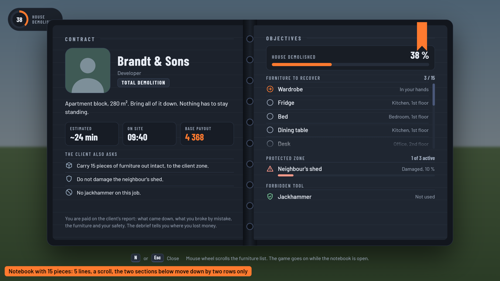

**Leave the site?** The check shown at the truck when the job is not finished.

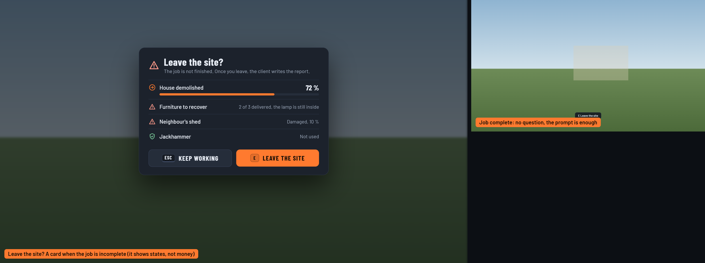

## Everywhere: the shop, the bag and the focus card

**Shop** with a cart.

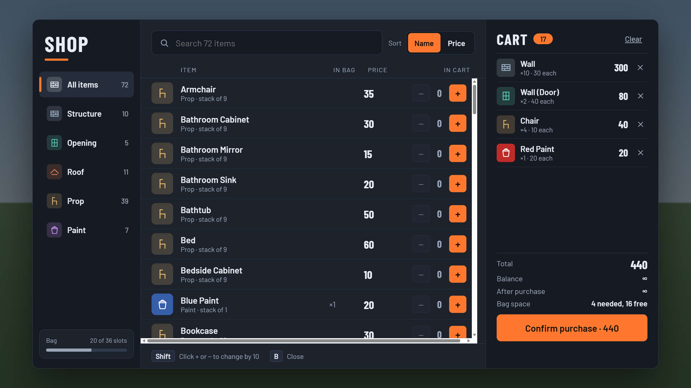

**Bag.**

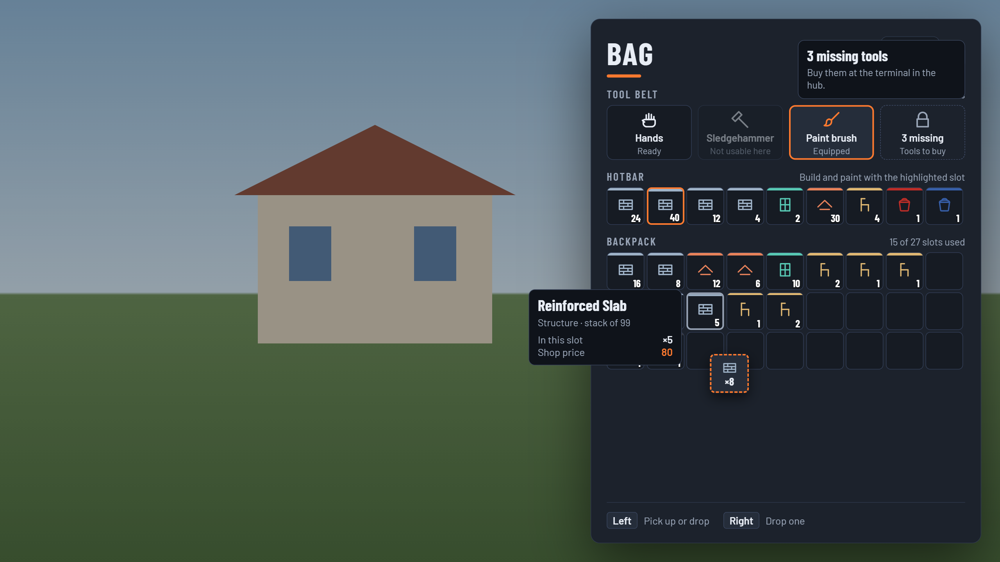

**Focus card** of the piece or the furniture under the crosshair.

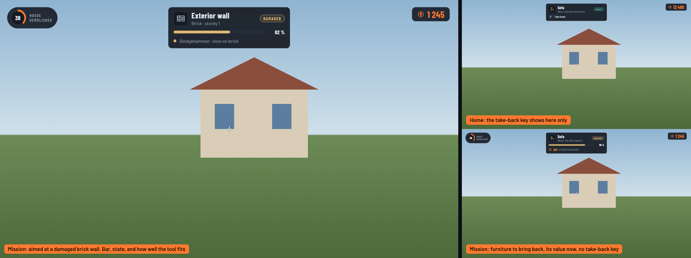

**Focus card states.**

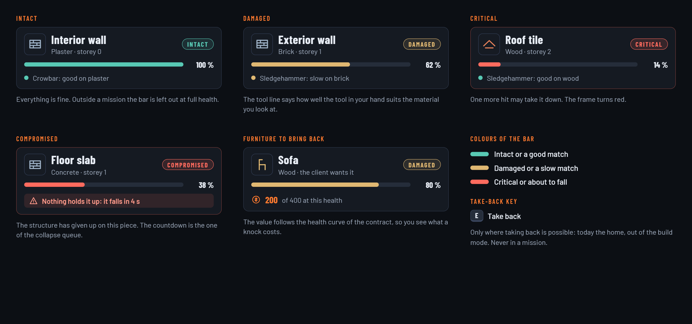
